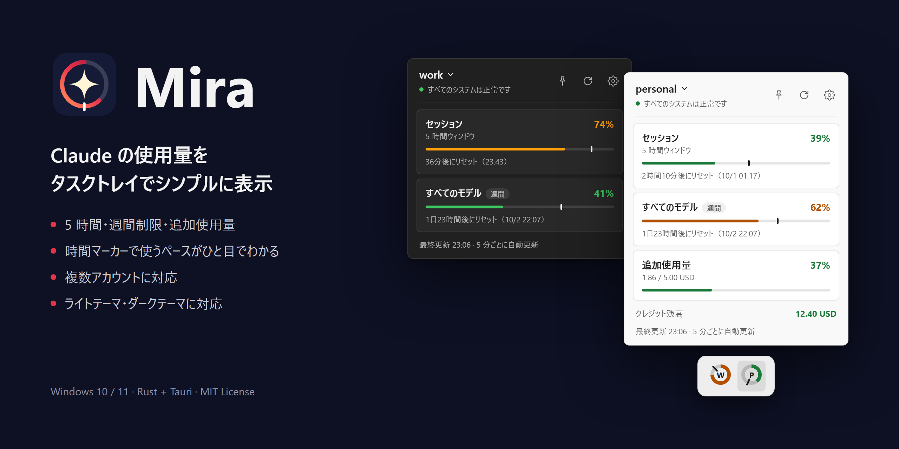

Mira は、Claude の使用量制限（5 時間、週間、追加使用量）を Windows のタスクトレイに表示するアプリです。

- Claude Code の設定フォルダごとに、トレイアイコンを 1 つ出します
- クリックすると、制限ごとの使用率、リセット時刻、使用ペースを示す時間マーカーを表示します

## ドキュメント

- [使い方](docs/usage.md)
- [安全のための設計](docs/security.md): 何を読み、何を書き、どこと通信するか
- [ビルドとリリース](docs/building.md)

## ライセンス

[MIT License](LICENSE)

このプロジェクトは [Claude-Usage-Tracker](https://github.com/hamed-elfayome/Claude-Usage-Tracker) を参考に制作されました。
